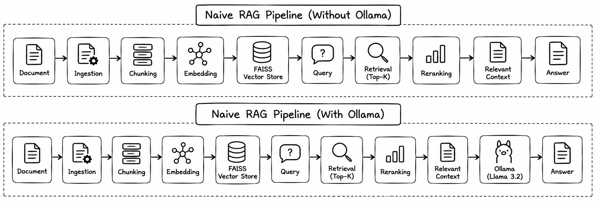
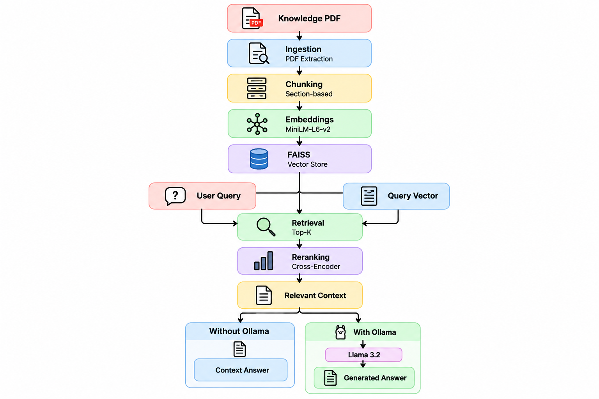

# Naive RAG — Retrieval-Augmented Generation

Naive RAG is a step-by-step Retrieval-Augmented Generation system built from scratch using Python.

The project demonstrates how a document can be ingested, divided into meaningful chunks, converted into embeddings, stored in a FAISS vector index, retrieved using semantic similarity, and reranked using a Cross-Encoder.

The project contains two implementations:

1. **Naive RAG without Ollama** — retrieves and reranks relevant document context and produces a context-based answer.
2. **Naive RAG with Ollama** — uses the same retrieval and reranking pipeline and adds a locally running Llama 3.2 model for final answer generation.

---

## Problem Statement

Large documents contain a significant amount of information, making it difficult to retrieve only the relevant information for a user's question.

A traditional keyword-based search may not understand the semantic meaning of a query.

This project addresses this problem by converting document content and user questions into vector representations and using semantic similarity search to retrieve relevant information.

A Cross-Encoder reranker is then used to improve the relevance of the retrieved results.

The Ollama implementation additionally uses a local LLM to generate a natural-language answer from the retrieved context.

---

## System Flowchart

### Naive RAG Pipeline

The project implements two versions of the Naive RAG pipeline:

- **Without Ollama** – retrieves and returns the most relevant context.
- **With Ollama** – uses Llama 3.2 through Ollama to generate the final answer.



---

## RAG Architecture



The Naive RAG system follows these main stages:

**Knowledge PDF → Ingestion → Chunking → Embeddings → FAISS → Query → Retrieval → Reranking → Relevant Context**

The final response differs between the two implementations:

- **Without Ollama:** Relevant context is returned directly as the answer.
- **With Ollama:** Relevant context is passed to **Llama 3.2** through Ollama to generate the final answer.

---

## AI Processing Pipeline

### 1. Document Ingestion

The knowledge PDF is loaded using PyMuPDF and the text is extracted.

### 2. Chunking

The extracted text is divided into meaningful section-based chunks.

### 3. Embeddings

Each chunk is converted into a numerical vector using:

`all-MiniLM-L6-v2`

### 4. Vector Store

The generated embeddings are stored and searched using:

`FAISS`

### 5. Query Processing

The user's question is converted into an embedding using the same MiniLM model.

### 6. Retrieval

FAISS performs similarity search and retrieves the Top-K relevant chunks.

### 7. Reranking

The retrieved chunks are reranked using:

`cross-encoder/ms-marco-MiniLM-L-6-v2`

This helps select the most relevant context for the question.

### 8. Answer Generation

#### Without Ollama

The highest-ranked relevant context is returned directly as the answer.

#### With Ollama

The relevant context is provided to:

`Llama 3.2 → Ollama`

The model generates the final answer based only on the retrieved context.

---

## Technologies Used

| Technology | Purpose |
|---|---|
| Python | Core development |
| PyMuPDF | PDF text extraction |
| Sentence Transformers | Text embeddings |
| all-MiniLM-L6-v2 | Embedding model |
| FAISS | Vector similarity search |
| Cross-Encoder | Result reranking |
| Pickle | Store chunks |
| Ollama | Local LLM inference |
| Llama 3.2 | Answer generation |

---

## Project Structure

```text
Naive_RAG/
│
├── with_ollama/
│   ├── data/
│   │   └── knowledge.pdf
│   ├── vectorstore/
│   │   ├── chunks.pkl
│   │   └── vectors.index
│   ├── pdf_text_vector.py
│   ├── question_vector.py
│   ├── reranker.py
│   ├── rag.py
│   └── requirements.txt
│
├── without_ollama/
│   ├── data/
│   │   └── knowledge.pdf
│   ├── vectorstore/
│   │   ├── chunks.pkl
│   │   └── vectors.index
│   ├── pdf_text_vector.py
│   ├── question_vector.py
│   ├── reranker.py
│   ├── rag.py
│   └── requirements.txt
│
├── docs/
│   ├── rag_pipeline.png
│   └── rag_architecture.png
│
├── .gitignore
└── README.md